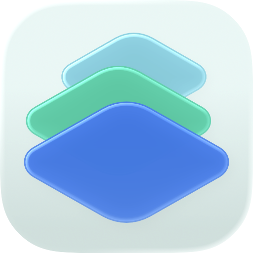
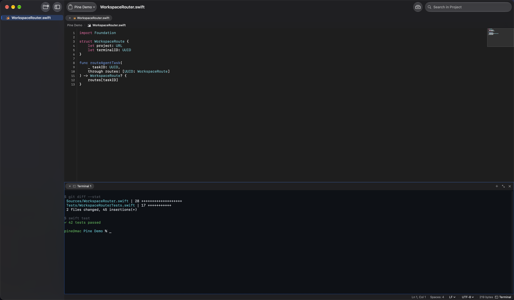
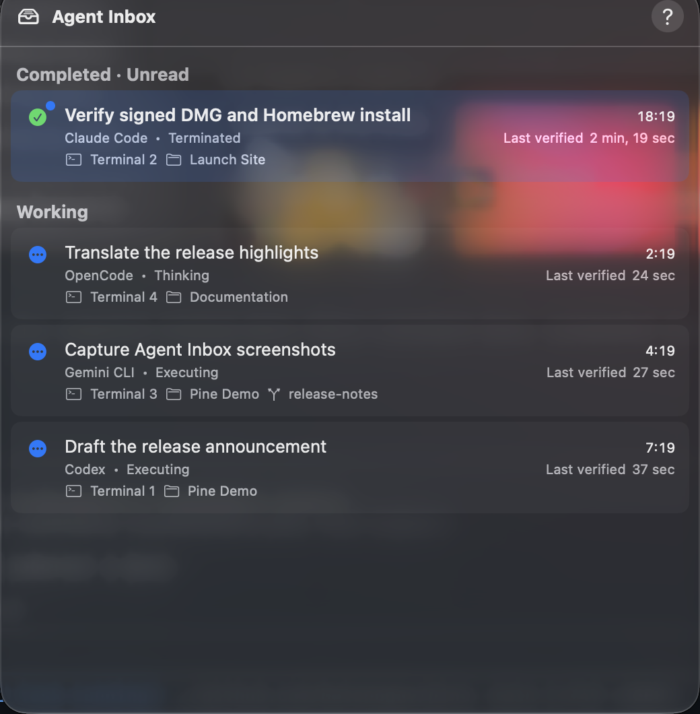
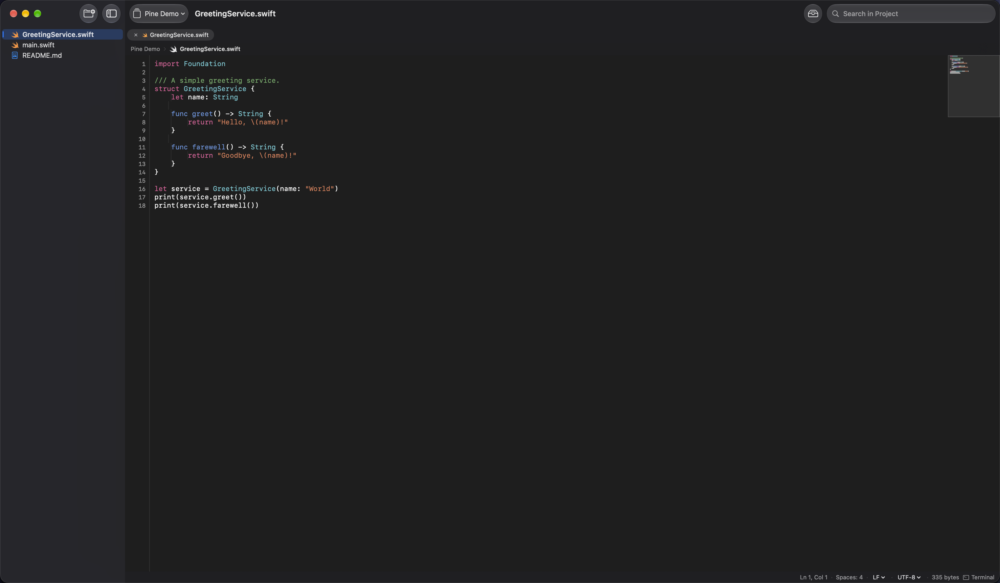
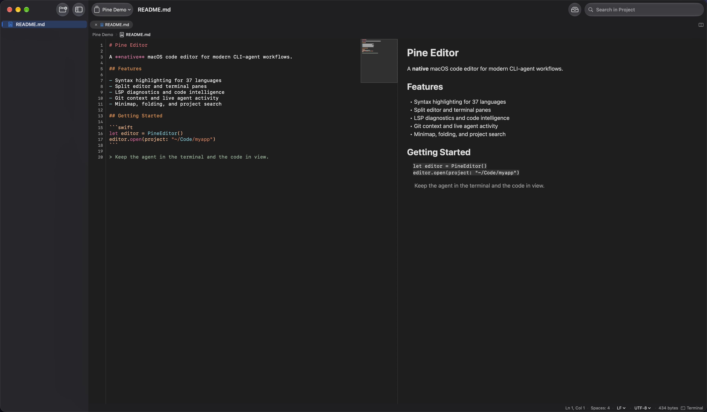
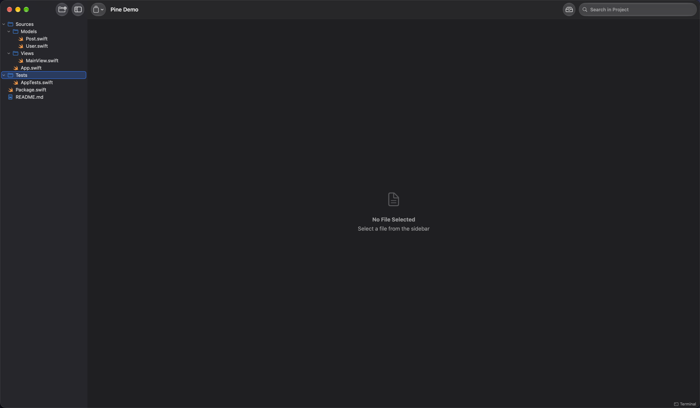
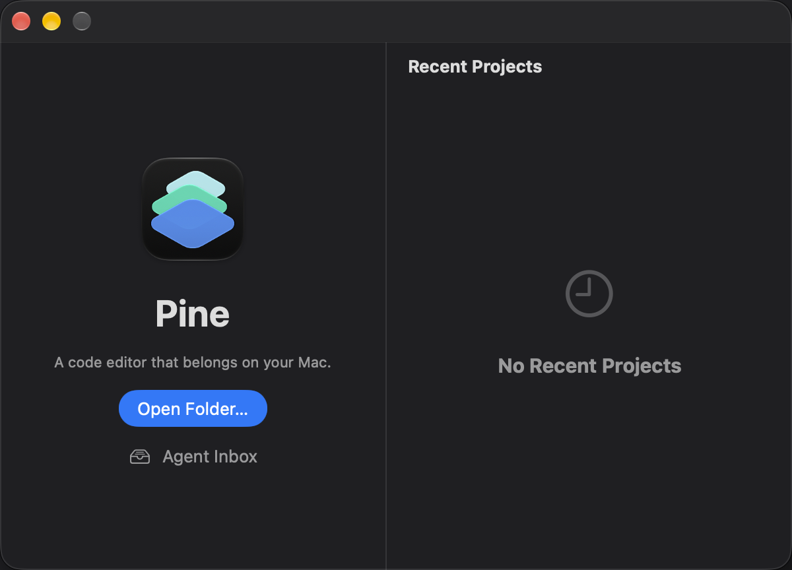

<p align="center">
  
</p>

<h1 align="center">Pine</h1>

[](https://github.com/batonogov/pine/actions/workflows/ci.yml)
[](https://github.com/batonogov/pine/releases/latest)
[](https://github.com/batonogov/homebrew-tap)
[](https://github.com/batonogov/pine/blob/main/LICENSE)
[](https://github.com/batonogov/pine)

> A native macOS code editor for CLI-agent workflows — heading toward an outcome-first Agentic Development Environment (ADE) in Pine 3.0.

<p align="center">
  
</p>

> **The agent stays in the terminal.**<br>
> **The code stays in view.**<br>
> **Pine brings them together.**

Pine reflects agent activity, file changes, diagnostics, and Git context across a fast native workspace without turning into another AI dashboard. Built with SwiftUI and AppKit for macOS 26 Liquid Glass — no Electron runtime.

Current released integrations detect processes, not verified waiting or success.
See the [compatibility matrix](docs/agent-compatibility.md) and its
[dated capability audit](docs/cli-capability-evidence-2026-11-14.md) for the distinction
between process detection, upstream interfaces, and verified Pine integration.

## One workspace for code and CLI agents

<p align="center">
  
</p>

- **Agents stay in real terminal sessions** while Pine keeps activity, files, diagnostics, and Git context visible beside them
- **Multi-project workspaces** keep related projects in one native window with fast switching and precise ownership
- **Cross-project Agent Inbox** preserves durable task context and routes back to the exact project, pane, and live session
- **Resilient terminal presentation** can rebuild a stalled display without restarting the shell or losing scrollback

See the [latest release](https://github.com/batonogov/pine/releases/latest) for the current changelog.

## Pine 3.0: the ADE direction

Pine 3.0 is heading toward an outcome-first **Agentic Development Environment (ADE)**: a workspace built around directing coding agents through durable tasks, not an editor with a chat panel attached. Where orchestration-centric tools optimize for agent throughput and visible activity, Pine optimizes for verified results and clear decisions.

These capabilities are **direction, not current functionality**, until they ship:

- **Durable tasks** — a task owns its goal, environment, checks, and result across navigation and relaunches
- **Verified results** — every Ready result carries Pine-observed checks and independent-review evidence bound to the exact code and environment
- **Attention over supervision** — the current project's task list surfaces Ready results and decisions that need you
- **Task-owned environments** — agents manage worktrees; Pine validates and binds the environment before implementation, checks, review, or result execution
- **Bounded parallelism** — independent same-repository tasks with validated routing and documented concurrency limits

See the [Pine 3.0 product vision](docs/pine-3.0-product-vision.md) for the full direction.

**In development, not in the latest release:** on `main`, the first structured
adapter (OpenCode V2 ACP) is integrated and dispatchable from the app, explicit
Verify with an independent adapter-backed reviewer is wired, and Ready-result
delivery is in flight. The [compatibility matrix](docs/agent-compatibility.md)
records exactly what each adapter proves.

**Describe it. Try it. Refine it.** Explore the
[interactive Pine 3 concept](https://batonogov.github.io/pine/#future):
project → task → result → contextual feedback. Its code/terminal and
project-switching controls predate the selected Pine 3 direction: one current
project and explicit Request/Command input, without an embedded code editor or
terminal emulator. Web, Go, Python, and DevOps examples use simulated data in a
Russian-language browser demo, not the downloadable app.
[Design discussion](https://github.com/batonogov/pine/issues/1735).

## Features

- **Native macOS** — SwiftUI + AppKit, Liquid Glass UI, system text handling. No browser engine, no runtime
- **Agent-aware workflow** — Agent Inbox keeps task context across projects and links to live sessions. Current process-only integrations send no agent notifications, including on process exit. Waiting-input, failure, and completion notifications require verified lifecycle events from a supported structured integration; no such integration is app-enabled yet. Released binaries may behave differently.
- **Multi-project workspaces** — Keep related projects in one native window, switch from the toolbar, and close one project without disturbing the rest of the workspace
- **Syntax highlighting** — bundled grammars for Swift, TypeScript, Python, Go, Rust, Java, Kotlin, Ruby, C/C++, and more
- **Adjacent terminal** — Keep an editor and a full-width terminal side by side, with a resizable divider and terminal zoom
- **Built-in terminal** — Full VT100/xterm emulator via [SwiftTerm](https://github.com/migueldeicaza/SwiftTerm) (upstream, with Pine's terminal-rendering patches merged in). Multiple tabs, themes, TUI apps, clickable file and OSC 8 links, send-to-terminal, pane maximize, a global quick-terminal hotkey, and display recovery that preserves the running shell
- **Lightweight extensibility** — User grammars, tasks, and keybindings without an extension marketplace
- **Git integration** — File status in sidebar, diff markers in gutter, and branch identity in task environment details
- **Markdown preview** — Source, rendered, or side-by-side via [swift-markdown](https://github.com/swiftlang/swift-markdown)
- **Status bar** — Cursor position, line endings, indentation style, file size
- **Bracket matching** — Highlights matching pairs while skipping strings and comments
- **File management** — Reveal in Finder, duplicate files with Finder-like naming
- **Large file handling** — Progressive loading for 10 MB+ files, optional highlighting disable for 1 MB+
- **Strip trailing whitespace** — Automatically cleans up on save
- **Validation & format on save** — YAML, shell, Dockerfile, and Terraform diagnostics with language-aware formatters
- **Auto-save & session restore** — Picks up where you left off
- **Auto-updates** — Built-in via [Sparkle](https://sparkle-project.org)
- **Localized** — English, German, Spanish, French, Japanese, Korean, Portuguese (BR), Russian, Simplified Chinese

<details>
<summary>Screenshots</summary>

### Code Editor


### Built-in Terminal


### Markdown Preview


### Agent Inbox


### Sidebar


### Welcome Screen


</details>

## Install

**Homebrew** (recommended):

```bash
brew install --cask batonogov/tap/pine-editor
```

**Direct download:** grab the latest `.dmg` from [Releases](https://github.com/batonogov/pine/releases/latest).

## Build from Source

Requires macOS 26+ and Xcode 26+.
Pine keeps a macOS 26.0 deployment target while also checking source compatibility with the macOS 27 SDK.

```bash
git clone https://github.com/batonogov/pine.git
cd pine
DEVELOPER_DIR=/Applications/Xcode.app/Contents/Developer \
  xcodebuild -skipPackagePluginValidation -project Pine.xcodeproj -scheme Pine build
```

Dependencies resolve automatically via Swift Package Manager on first build.
See [DMG packaging](docs/dmg-packaging.md) to build and visually preview the
release disk image without publishing a release.

## Keyboard Shortcuts

| Shortcut | Action |
| --- | --- |
| `Cmd+Shift+O` | Open folder |
| `Cmd+S` | Save |
| `Cmd+Option+S` | Save All |
| `Cmd+Shift+S` | Save As |
| `Cmd+Shift+D` | Duplicate file |
| `Cmd+W` | Close tab |
| `Cmd+/` | Toggle comment |
| `Cmd+Shift+A` | New agent in a worktree |
| `Cmd+Shift+P` | Markdown preview |
| `Ctrl+Option+Down` / `Up` | Next / Previous change |
| `` Cmd+` `` | Toggle terminal |
| `Cmd+T` | New terminal tab |
| `Cmd++` / `Cmd+-` | Zoom in / out |
| `Cmd+0` | Reset font size |

## Architecture

MVVM with SwiftUI views backed by AppKit via `NSViewRepresentable`. The editor core uses the native NSTextStorage/NSLayoutManager/NSTextContainer stack. Syntax highlighting runs asynchronously on a background queue with generation tokens to prevent stale results. Git operations run in parallel via GCD.

## Contributing

Contributions are welcome. Please open an issue first to discuss what you'd like to change. See the [Issues](https://github.com/batonogov/pine/issues) page.

## License

[MIT](LICENSE)
