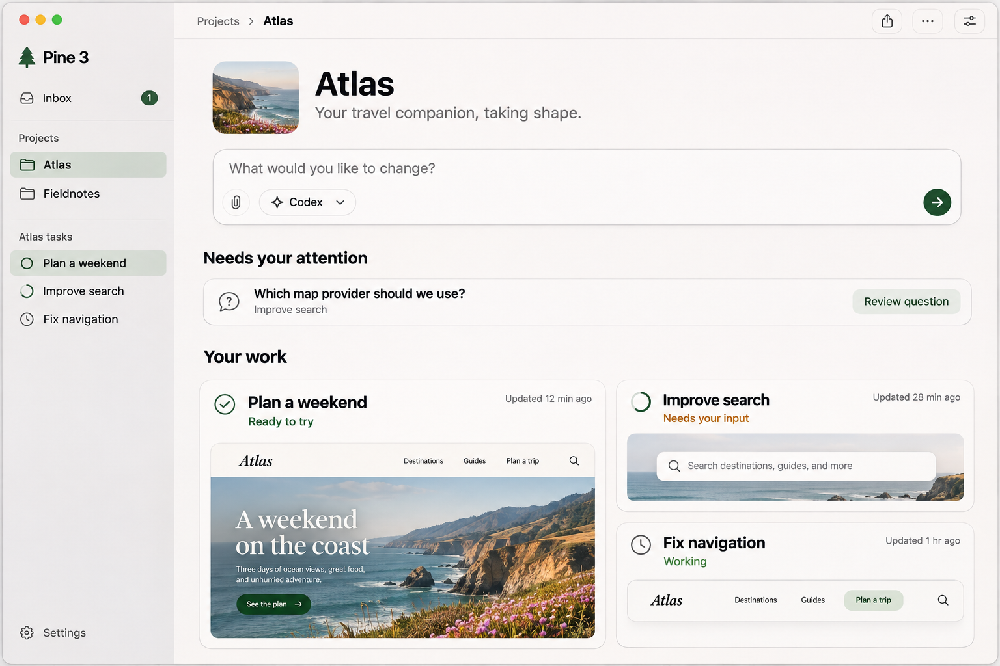
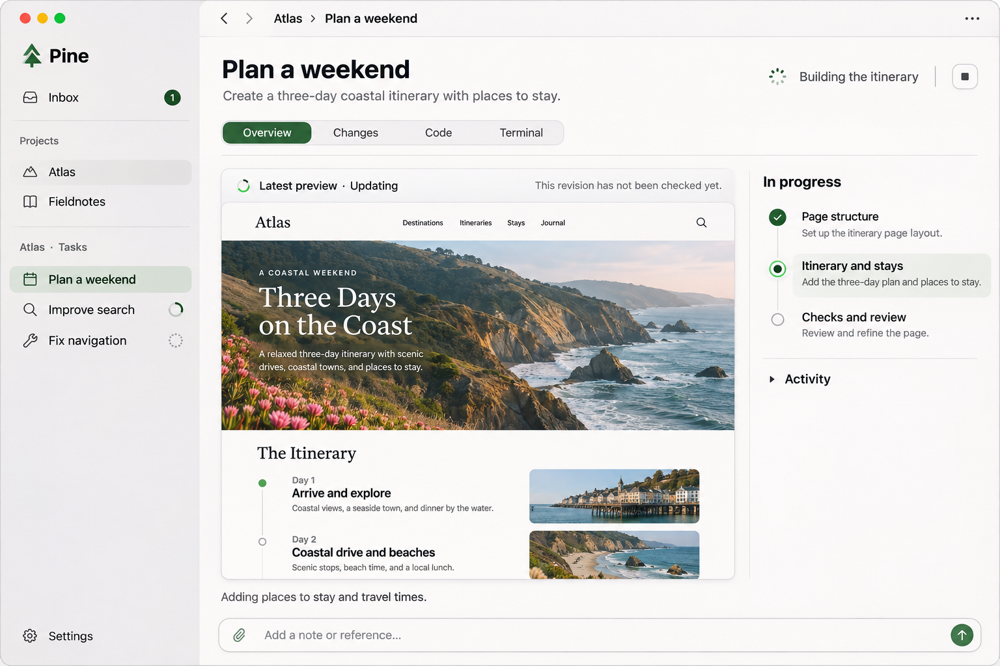
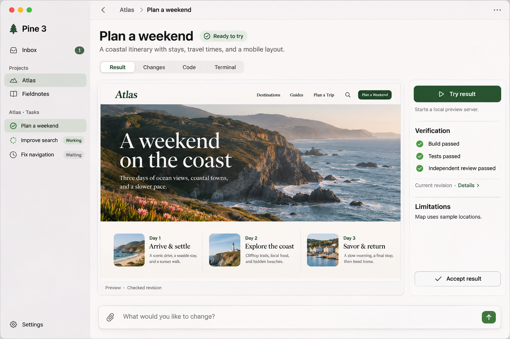
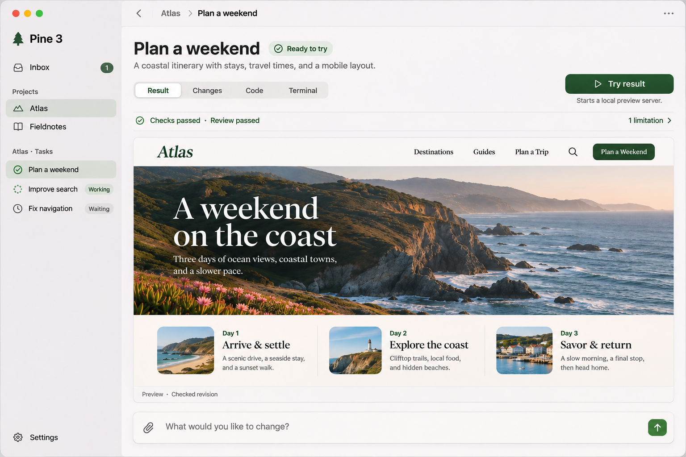
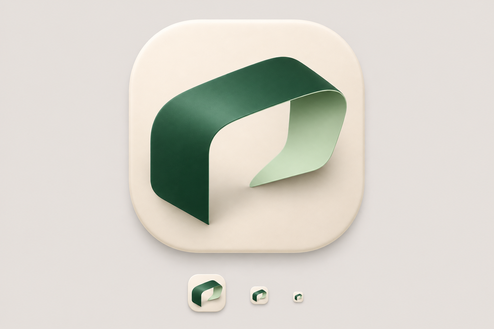
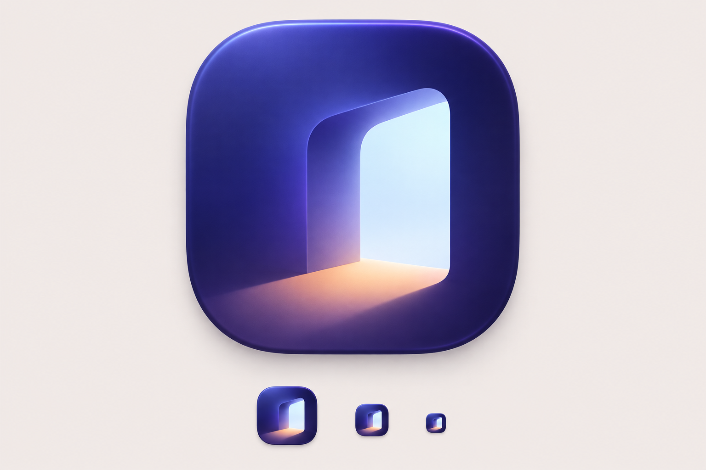
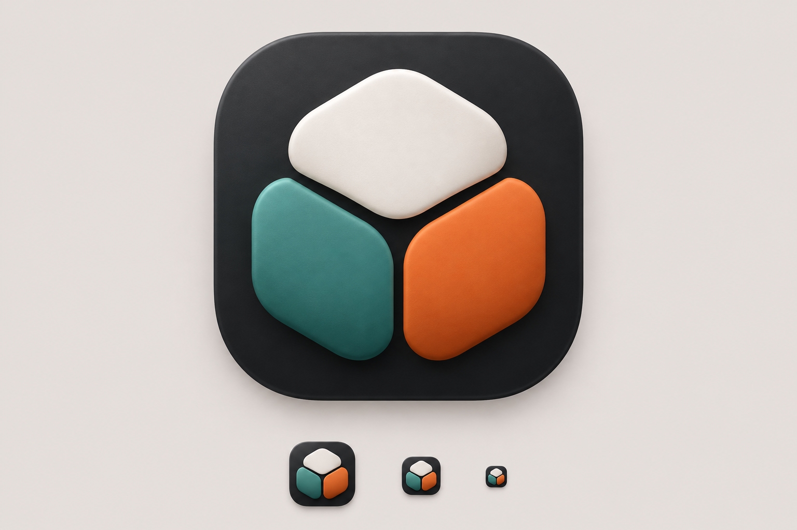
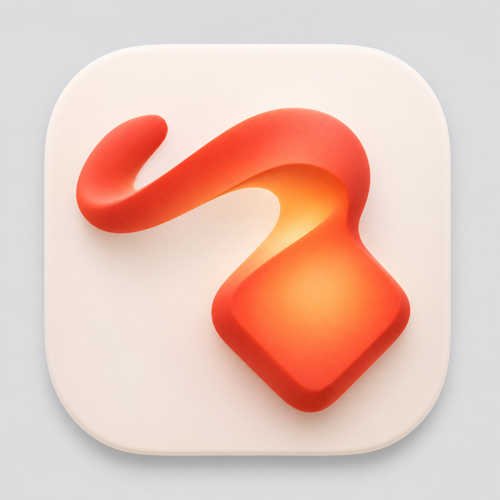

# Pine 3 design exploration

Exploratory AI-generated raster concepts, created on 2026-11-12 with the built-in ImageGen tool for discussion with the maintainer. These are not shipped screenshots, production app icons, or approved final designs. Fictional Atlas content illustrates a web project; Pine also supports native, CLI, library, documentation, and other project types.

Tracking: [workspace design #1735](https://github.com/batonogov/pine/issues/1735), [new identity #1736](https://github.com/batonogov/pine/issues/1736), [Pine 3 milestone](https://github.com/batonogov/pine/milestone/16).

## Workspace concepts

### Project overview

Start a task, see concrete questions, and return to current work.

### Task in progress

Task context surrounds an intermediate artifact. Progress and previews depend on actual CLI and project capabilities. No fabricated plan or preview is required for unsupported projects.

### Result, first iteration

A persistent right inspector contains trial, evidence, limitations, and acceptance.

### Result, second iteration

The inspector is removed to give the artifact more room. Evidence and limitations become compact disclosures. The universal “Try result” label shown in the image is superseded: use concrete labels such as “Open preview”, “Run application”, or “Run example”. Some results need no execution action.

The images contain exploratory inconsistencies: sidebar selection, icons, task names/statuses, and Overview/Result labels are not a finalized navigation specification. The icon/tree branding shown in workspace concepts predates the new identity exploration below. Green checks represent a hypothetical checked revision, not real verification. See #1735 for the behavioral contract: viewing, running, and accepting are distinct; current Pine-observed checks and independent review are required for Ready. Acceptance discoverability still needs design validation.

Pine launches and communicates with existing CLI agents. Planning, reasoning, and implementation remain with those agents; this workspace does not introduce a Pine-owned coding agent or model tool loop.

## New application icon directions

A completely new identity is requested for Pine 3. The original A/B/C directions below are historical and rejected; see the maintainer selection update for the retained candidate. No final production identity is selected, and the application icon is not changed by this archive.

### A — Fold

An evergreen/celadon band on porcelain: intent taking shape into a workspace.

### B — Aperture

An indigo opening with cool interior and warm light: a new space of possibility.

### C — Assembly

Three forms on charcoal: separate work becoming a coherent result.

These initial directions were rejected by the maintainer. A resembles Excel, B feels heavy and its lighter variants miss the product vision, and C lacks a meaningful identity. All require original production geometry, similarity review, and actual small-size testing. The small examples painted into each board are illustrative, not measured Dock or 16/32/64 px exports. These are presentation boards with backgrounds, not drop-in icon assets.

## Generation briefs

Tool: built-in ImageGen. No CLI/API fallback. These concise briefs record the visual intent; they are not deterministic reproduction instructions.

- Shared workspace brief: a high-fidelity native macOS Pine 3 window, warm white content, translucent gray project/task sidebar, restrained forest-green accent, SF-like typography, and task-centered navigation. Fictional Atlas travel site provides an artifact. Preserve code, changes, and a real CLI terminal as accessible views.
- Overview: new-task composer, concrete question, and current work with available artifact previews.
- Working: unchecked intermediate artifact, honest progress summary, collapsible activity, and continuation input.
- Result v1: large static artifact with a right inspector for explicit trial, checks/review, limitations, and separate acceptance.
- Result v2 edit: preserve the first result's visual language; remove the right inspector, widen the artifact, move trial into the top toolbar, evidence into a disclosure row, and acceptance into secondary actions pending discoverability review.
- Shared icon brief: a completely new original macOS ADE icon, strong silhouette, restrained tactile depth, large icon and illustrative smaller variants on a neutral background. Explore beyond trees, terminal prompts, robots, code brackets, or generic AI sparkles. These prompt exclusions are exploration choices, not final brand restrictions.
- Fold: one continuous evergreen/celadon folded band forming an abstract open frame on warm porcelain.
- Aperture: an indigo rounded architectural opening, pale blue interior, and one warm peach light plane.
- Assembly: three broad interlocking pearl, teal, and burnt-orange forms on charcoal with clear central negative space.

All PNGs are preserved as generated, without raster edits. The selected brand direction should be rebuilt as editable production artwork rather than promoting a presentation-board crop into the app.

## Maintainer selection update

The original A/B/C directions are historical, rejected exploration: A resembles Excel, B is too heavy (lighter doorway/glass variants also miss the vision), and C lacks a meaningful identity. They are not shortlisted.

### Candidate 1 — Intent taking form

The maintainer explicitly requested preserving this candidate for further exploration. A warm coral gesture resolves into a shaped object; the maintainer also sees a torch and a snake. Preserve the energy and fluidity while evaluating those associations. This is approval to retain a candidate, not final production-icon selection.

Generation brief (built-in ImageGen): one original macOS icon, a broad fluid gesture becoming a precise crafted form, warm vermilion/coral with amber inner light on porcelain, restrained dimensionality, strong silhouette. No text, tree, robot, terminal glyph, doorway, or generic AI sparkle. The resulting shape is exploratory.

Target: three maintainer-approved candidates in #1736. Show further concepts individually and add them only after explicit approval.
