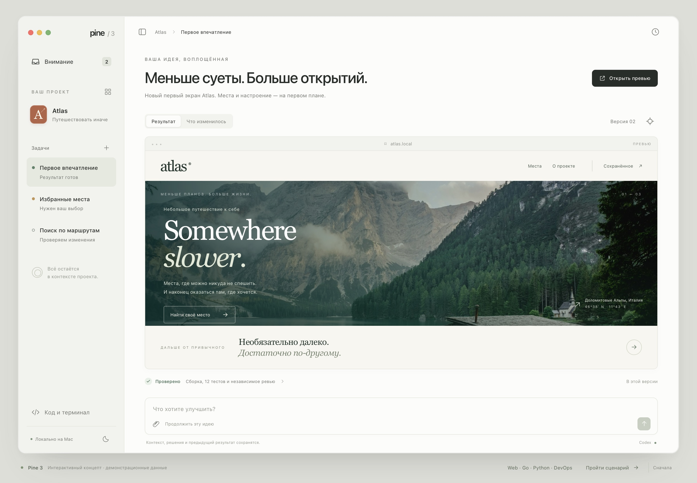
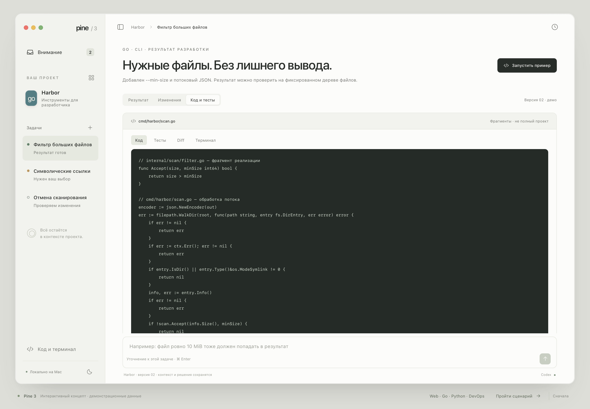
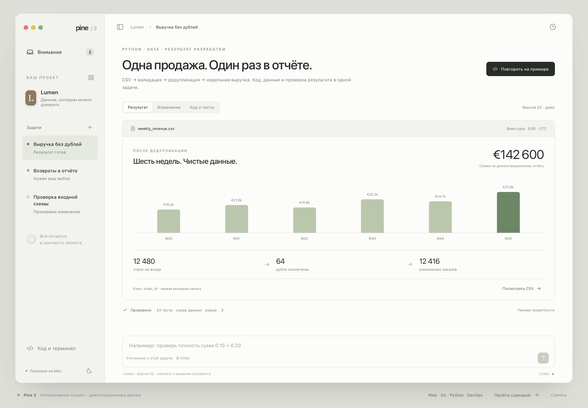
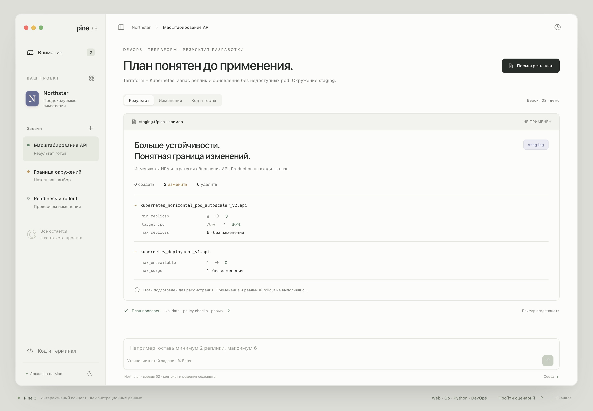

# Pine 3 — interactive browser concept

Interactive design exploration for [workspace design #1735](https://github.com/batonogov/pine/issues/1735),
[feedback #1758](https://github.com/batonogov/pine/issues/1758),
[subtraction #1760](https://github.com/batonogov/pine/issues/1760), and
[comparative validation #1762](https://github.com/batonogov/pine/issues/1762).
Not an approved final design or a screenshot of implemented Pine functionality.

The maintainer welcomed this direction and explicitly endorsed keeping code and
the terminal out of the foreground. Preserve **project → task → result →
refinement**, with full developer tools available in context. See the
[recorded design feedback](https://github.com/batonogov/pine/issues/1735#issuecomment-6863196763).

Base: `421a54a3258583c396d52f977fd8206ceff2c5a3`.

## Open

Open `index.html` directly, or serve **this directory only**:

```sh
python3 -m http.server 8763 --bind 127.0.0.1 --directory docs/design/pine-3/prototype
```

Then visit <http://127.0.0.1:8763>.

### Direct scenarios

- [Web — Atlas](index.html)
- [Go — Harbor, implementation and tests](index.html?project=go&view=code)
- [Python — Lumen, implementation and tests](index.html?project=python&view=code)
- [DevOps — Northstar, infrastructure plan](index.html?project=devops)

## Explore

- Start with a usable result for the fictional Atlas travel project.
- Open the larger preview or compare the current and previous composition.
- Select the target icon, anchor feedback to the hero, and submit an instruction.
- The working state advances only through **Показать следующий шаг демо**;
  no agent or actual build is running.
- The predefined revised composition has less copy and a clearer primary action.
  Arbitrary prompts are retained as demo feedback, not interpreted by a model.
- Visit the question in **Избранные места**, answer it, then return to Atlas.
- Inspect example checks, task history, and contextual files/diff/terminal.
- Try the dark appearance using the sidebar button and compact browser widths.
- **Пройти сценарий** offers a five-part walkthrough.
- **Web · Go · Python · DevOps** (below the window), or the project picker in the
  sidebar, switches between four independent demo projects:
  - **Harbor / Go:** a streaming CLI file scanner; command, JSON Lines output,
    implementation, boundary regression test, and `>` → `>=` correction.
  - **Lumen / Python:** CSV deduplication and weekly revenue; report, source data
    counts, exact-money test, and float → Decimal correction.
  - **Northstar / DevOps:** Terraform/Kubernetes staging plan, resource diff,
    policy checks, environment decision, and an updated replica minimum.
- Developer projects expose **Результат / Изменения / Код и тесты** directly in
  the main workspace. Their feedback, choices, revisions, and drafts remain
  separate when changing projects.
- Direct links: `?project=go`, `?project=python`, `?project=devops`.

Developer snippets are illustrative fragments, not complete runnable projects.
Current example checks are distinct from the new regression tests introduced in
the refinement flow. The Go/Python/DevOps actions display simulated output and
never run a local binary, read user files, deploy, or apply infrastructure.

There are no external runtime dependencies, analytics, API calls, executable
commands, or browser persistence. Optional images stay in the current page as
local object URLs; the app never uploads them. Reloading resets the demonstration.
All agent/check/reviewer facts are explicitly fictional.

## Visual direction

A quiet native-inspired shell, a restrained project/task sidebar, and a large
result surface. Evidence and tools are contextual rather than permanent panels.
The imagery and serif typography belong to the **fictional user's product**;
Pine's own shell uses system typography. The wordmark is provisional and does not
select or replace the app icon under #1736.

This prototype explores one composition. It does not complete #1735's required
comparison of materially different designs or establish native-app, VoiceOver,
performance, provider, or end-to-end release acceptance.

The interface text is Russian, matching the design discussion. This is an
isolated design artifact; it does not replace the localized landing page or the
current product's marketing screenshots. Public positioning and a localized
landing entry point remain with [#1730](https://github.com/batonogov/pine/issues/1730).

## Representative captures

Browser-rendered captures of this prototype, with fictional data. These record
the explored composition, not the native application.

### Web: result and refinement



### Go: implementation and regression test access



### Python: data-processing result



### DevOps: plan before application



## Image source

The sample photograph is downloaded locally from this public Unsplash image URL:

<https://images.unsplash.com/photo-1470770841072-f978cf4d019e?auto=format&fit=crop&w=1800&q=85>

It is illustrative Atlas content, not Pine branding or a production asset.
The location label is fictional demo copy, not a verified photograph geolocation.
Unsplash license reference: <https://unsplash.com/license>.
