# Pine 3 main-window compositions — comparison

Status: design exploration for issue [#1735](https://github.com/batonogov/pine/issues/1735).
These are concrete candidate designs, not approved UI. The raster concepts in the
[design archive](https://github.com/batonogov/pine/blob/9f54549211ae449bbaf5cd76128aca1d4ce194a8/docs/design/pine-3/README.md)
(conserved from PR #1737, pinned at `9f545492`) establish one direction — Composition A below
carries it forward in vector form.

The question each composition must answer: **how does the main window visibly and
*behaviorally* express project/task/result work?** Restyling the 2.x IDE shell (file tree
beside editor and terminal panes) does not qualify — the new way of working must be
apparent from the moment the window opens, in the structure of the window itself.

## The baseline being replaced as the home

Pine 2.x opens a project into a `NavigationSplitView`: a Finder-style file-tree sidebar
left of a split pane tree of editor and terminal leaves, with a Welcome window over recent
projects. The Agent Inbox routes to live sessions. That shell is excellent for *editing*
and remains fully available inside task context (see
[interaction-spec.md](interaction-spec.md#5-manual-workflow-preservation)). What it does
not express is the ADE journey — start work, return to it, answer questions, inspect a
result you can try, give feedback — because the file tree, not the work, is the home.

## What "materially different" means here

Four axes define a main-window composition:

1. **Home surface** — what the window shows when a project opens.
2. **Column model** — how many persistent columns exist, and what they own.
3. **Where code, diff, and terminal live** — tab, split, overlay, or default home.
4. **Where the result is presented** — full-width surface, floating sheet, or inline card.

The three candidates differ on at least two axes each.

| | A — Project canvas | B — Terminal canvas | C — Attention flow |
|---|---|---|---|
| Home | Project overview | The task's real CLI terminal | The cross-project attention queue |
| Columns | Sidebar + content (2) | Task rail + terminal (+ optional split) (2–3) | Single content column (1), no rail |
| Code / diff / terminal | Tabs inside the task | Terminal *is* the home; code/diff split beside it | Tabs inside the pushed surface |
| Result presentation | Full-width surface with compact evidence row | Sheet summoned over the terminal | Full-width pushed surface |
| Navigation | Document-style (breadcrumb + sidebar) | Terminal-anchored, result as overlay | Push stack with system back |

---

## Composition A — Project canvas (the archive direction, refined)

Carries the archive's structure — compact sidebar (Inbox, projects, human-named tasks)
plus a content column that presents project overview, task workspace, and result as
document-style surfaces — and refines it to a concrete spec.

- 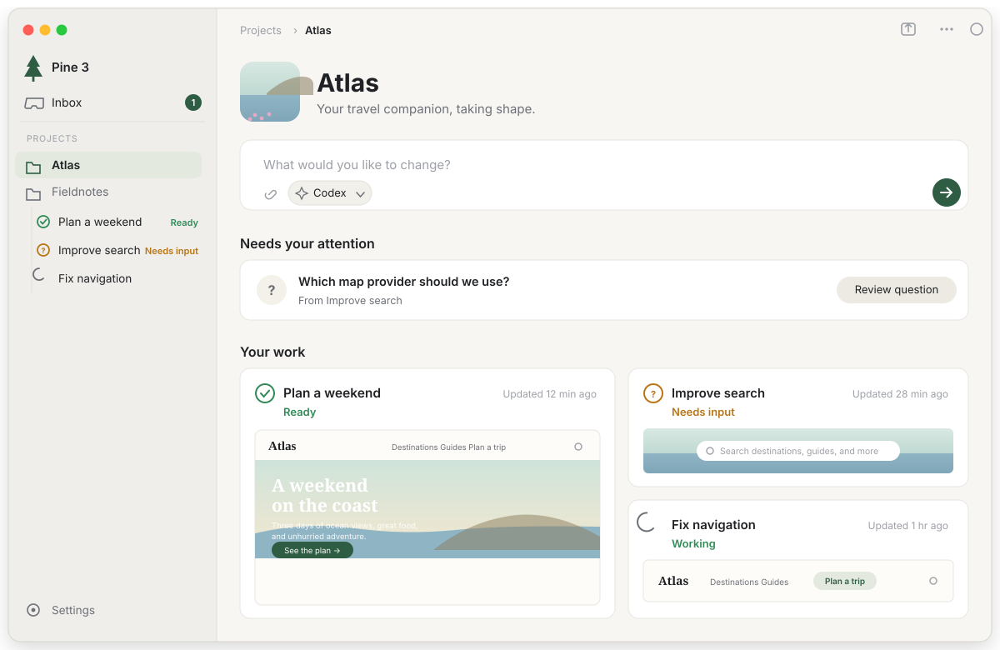
- 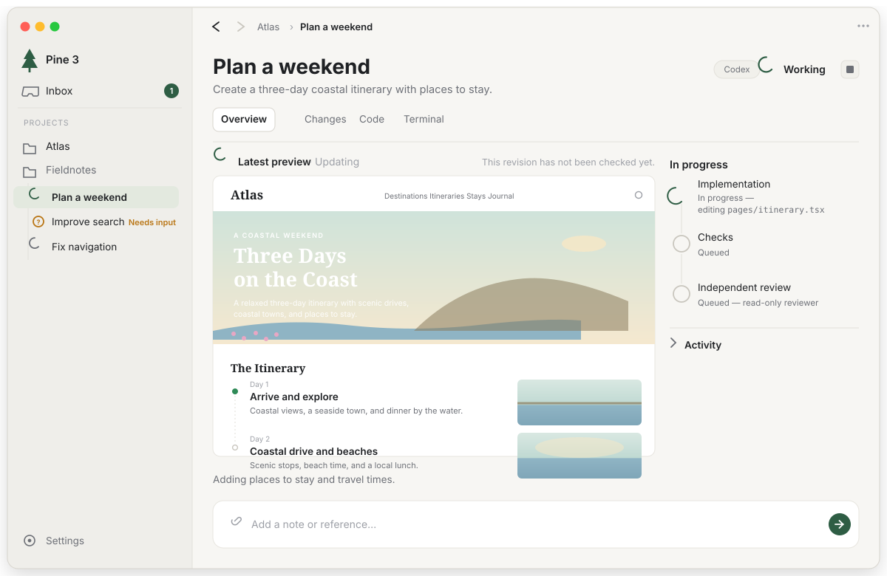
- 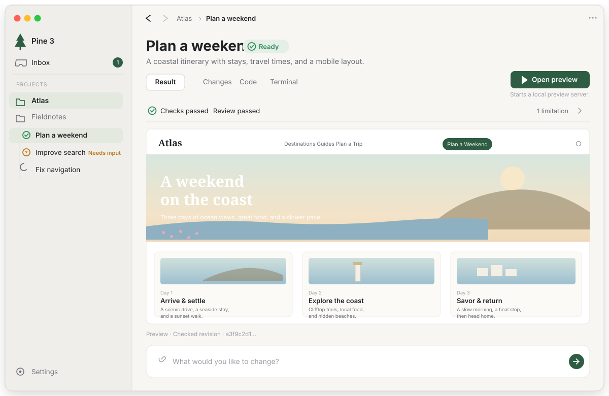
- 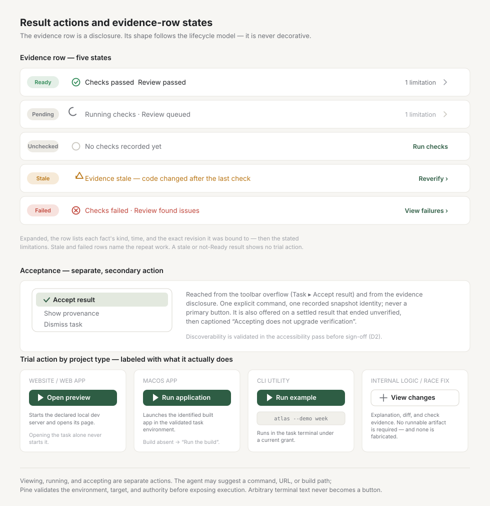

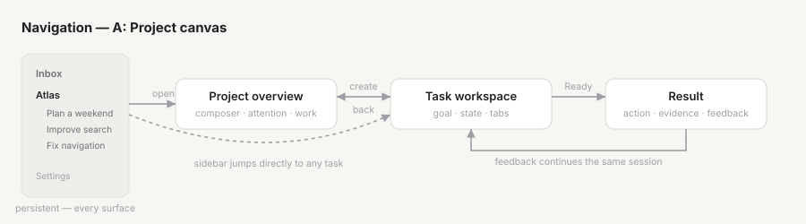

### Refinements over the archive mockups

The archive README lists known inconsistencies (sidebar selection, icons, status
wording, Overview/Result labels, the universal “Try result” button). This candidate
resolves them as follows:

1. **One sidebar hierarchy, not duplicated sections.** Tasks nest under their project
   node (collapsible) instead of a parallel “Atlas tasks” section that re-selects the
   project. Inbox is top-level; Settings is pinned bottom. Selection is always exactly
   one row — a project (overview) or a task (workspace/result).
2. **Status glyphs with sparse words.** A task row shows a state glyph; a short status
   word appears only for states that matter to the user (Ready, Needs input,
   Failed, Stale, Queued). Working shows an animated arc (static “Working” under
   Reduce Motion).
   Provider identity is never in the sidebar — it lives in task details, per the issue.
3. **No universal trial button.** The result action is concrete per project type
   (“Open preview”, “Run application”, “Run example”, …), with a one-line caption stating
   exactly what it does. Non-runnable results carry no trial button — “View changes”
   *is* the presentation (see the action matrix in
   [composition-a-evidence-states.svg](assets/composition-a-evidence-states.svg)).
4. **Compact evidence row, real states.** One hairline row under the tabs:
   provenance (checks, independent review) on the left, limitations count on the right,
   each a disclosure into the full provenance list. The row changes shape with the
   lifecycle model — verified, pending, unchecked, stale, failed — never a reassuring
   green when the model says otherwise.
5. **Acceptance is a separate, secondary action** — not a primary button. It is reached
   from the toolbar overflow (Task menu) and from the evidence disclosure, both shown
   in the states SVG. Its discoverability is an open validation item (D2 in
   [recommendation.md](recommendation.md)).
6. **Honest “In progress” rail.** The task rail shows (a) current execution state with
   the last real agent signal, (b) Pine's own fixed phases — checks, independent review
   — with their real status, and (c) a collapsed Activity disclosure with the raw
   provider stream. No invented plan steps, no percentages, no live preview where the
   project cannot supply one.
7. **The tab that changes name is one tab.** During work it reads “Overview”; when the
   task becomes Ready it reads “Result”. There is no second tab duplicating the same
   artifact (see D4).

### Behavioral expression

- **Project.** Opening a project lands on its overview: identity, the new-task composer
  as the dominant element, the questions that need *you* (“Needs your attention”), and
  current work as cards — with result thumbnails only where a genuine artifact exists.
  The sidebar projects → tasks tree *is* the project structure.
- **Task.** Selecting a task moves the content column to the task's workspace: goal as
  title, truthful current state in the header (working / needs input / result ready /
  evidence stale / failed — exactly the words the lifecycle model supports), tabs for
  the material (changes, code, real terminal). The window header state changes *because
  state changed* — execution `working` animates the glyph; `blocked` surfaces the
  question card and adds the task to the Inbox; settlement to Ready rewords the header
  and renames the tab.
- **Result.** The Ready result occupies the full content width. The concrete trial
  action sits in the toolbar row with its side-effect caption; the evidence row below
  the tabs states provenance and limitations at a glance; the feedback composer at the
  bottom continues the same CLI session. Viewing changes only the read state.

### Strengths

- Closest to the interaction model the issue already sketches (sidebar → overview →
  task workspace → result), and to the mockups the maintainer iterated twice on — the
  least speculative path to sign-off.
- Stable two-column place-sense: the sidebar never disappears, so project and task
  identity survive every navigation and relaunch.
- Full width for artifacts is exactly what “try the result” needs for a web preview,
  a rendered document, or a diff.
- Progressive disclosure is native: evidence row → provenance list; Activity collapsed
  by default; details in the overflow menu.
- The Inbox already exists in 2.x; A reuses it unchanged as the cross-project
  attention queue, so C's strongest idea folds in without a new architecture.

### Risks

- **Dashboard drift.** The overview card grid is the most web-like element in the
  design; it must stay a *list of work with available artifacts*, not a marketing
  collage. Mitigation: one-column collapse at compact width, thumbnails only when a
  real artifact exists, no decorative cards.
- **Sidebar growth.** Many projects × many tasks needs grouping discipline: tasks nest
  under their project, collapsed by default except the selected project's; Inbox keeps
  attention cross-project.
- **Tab depth.** Result/Changes/Code/Terminal plus breadcrumbs is two navigation levels
  before the terminal; power users may feel a step removed from their muscle memory.
  Mitigation: keyboard shortcuts for tabs and the manual-workflow preservation rules
  (the real terminal is one Tab away and fully featured).
- **Most new structure.** A introduces the most new surfaces of the three; it has the
  most to build and the most to get subtly wrong. That is also why it most needs the
  vector-spec comparison done here before implementation.

---

## Composition B — Terminal canvas (terminal-first hybrid)

The real CLI agent terminal *is* the task home. A thin task rail (Inbox, projects,
tasks) sits left of a dominant terminal surface. The result is not a tab — it is a
sheet summoned from the rail or the Inbox when the task becomes Ready or needs a
decision. Code and diff open as a split beside the terminal, reusing 2.x pane
behavior. The “overview” is a one-line status strip above the terminal plus a
collapsible activity drawer; there is no separate overview screen.

- 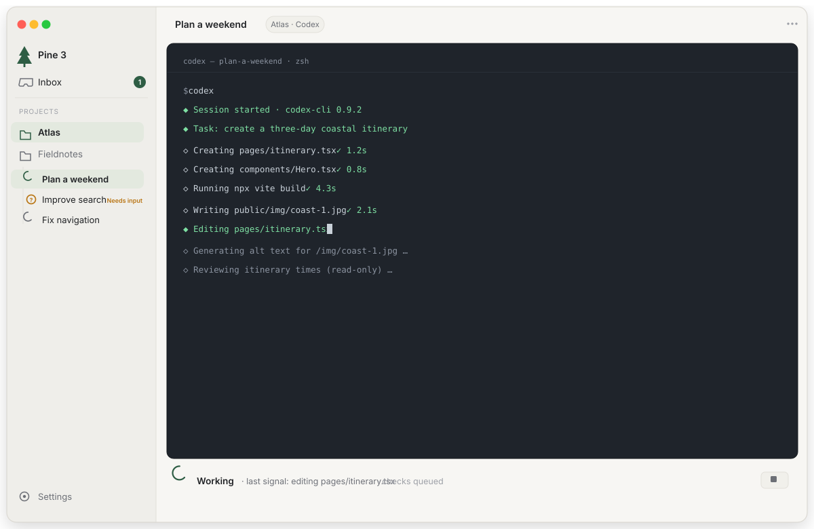
- 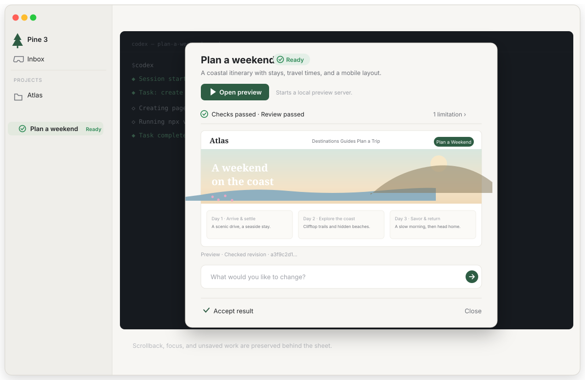
- 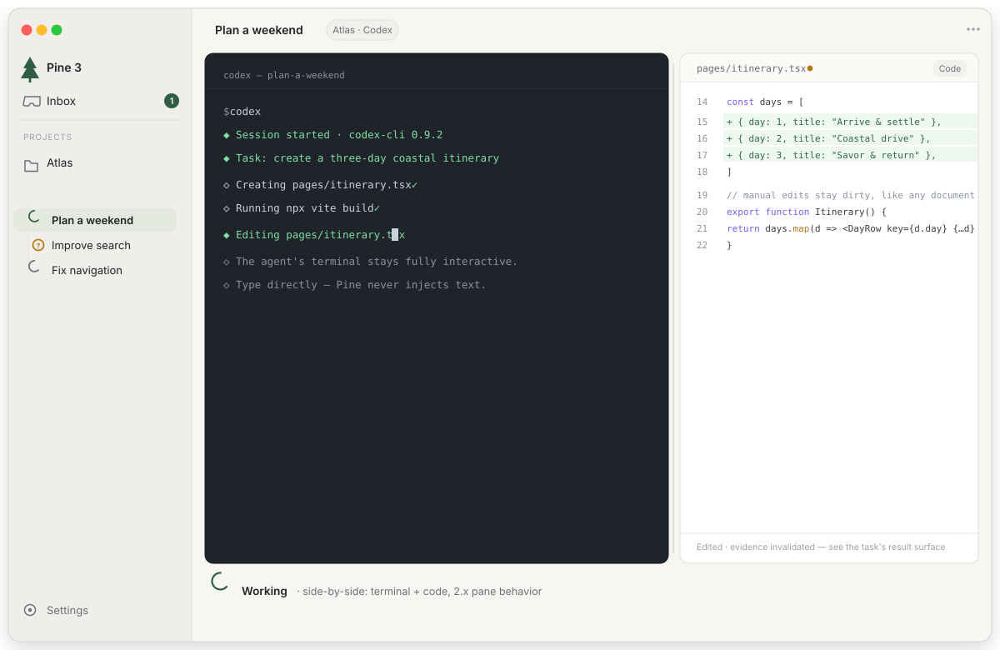

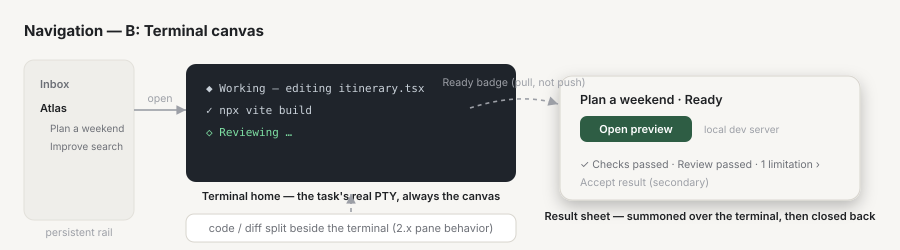

### Behavioral expression

- **Task = terminal.** Work is expressed by what the terminal shows — the truth of
  what the agent is actually doing, with no intermediate interpretation layer.
  Pine chrome (status strip, rail glyphs) adds the lifecycle dimensions on top.
- **Result = summon.** The Ready state puts a badge on the task row and in the
  toolbar; invoking it opens a floating sheet with the artifact, the concrete trial
  action, and the evidence row. The sheet closes back to the terminal without losing
  scrollback or unsaved editor state.
- **Code/diff = split.** Manual intervention is a split action, exactly the 2.x
  pane model.

### Strengths

- Maximum honesty by construction: the default view is the actual process output;
  there is nothing to fabricate or drift from.
- Best continuity with 2.x power users: the terminal-first muscle memory survives
  intact, and Pine's split/terminal architecture is reused rather than replaced.
- The sheet presentation gives the result moment real focus — the whole window
  darkens behind it, which is a strong place-sense signal for “decision time”.

### Risks

- **It keeps the familiar IDE problem.** The issue's motivation states that a familiar
  shell does not make the new way of working apparent; a terminal-dominant home is the
  familiar shell with a badge on it. A first-time user opens the app and sees
  scrolling CLI text, not their work.
- **Result discoverability is pull, not push.** A Ready result that lives behind a
  badge competes with terminal scrollback for attention; the “attention replaces
  supervision” pillar says Ready must be found easily, not hunted.
- **Aesthetic conflict.** A dark terminal dominating a warm, light, restrained Mac
  surface splits the visual identity; the warm-white language the archive commits to
  has no home in B.
- **Authority tension.** The surface that dominates the window is, by contract,
  untrusted text that must never become execution authority. B makes the untrusted
  surface the center of gravity.

### Tradeoffs

B is the correct answer for users who live in the terminal — and A already serves
them: the Terminal tab is the same real PTY, one keystroke away, with split layouts
available in task context. B as the *default home* optimizes for the power user at
the cost of the product's outcome-first identity. Retained as the strongest counter
argument in the comparison; see D1.

---

## Composition C — Attention flow (single-column stack)

One content column, no persistent rail. The window is a push stack in the Mail/Apple
Music idiom: **Inbox (home) → Project overview → Task → Result**, each push a
full-window surface with a system back control. Projects are a section *within* the
Inbox screen. Composer, evidence row, and feedback behave as in A, but every surface
is a single column that owns the full window width.

- 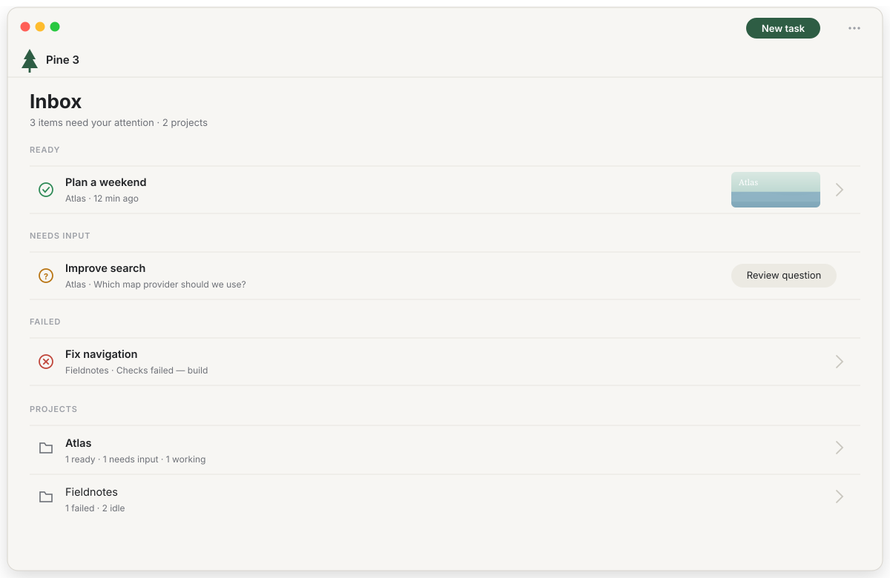
- 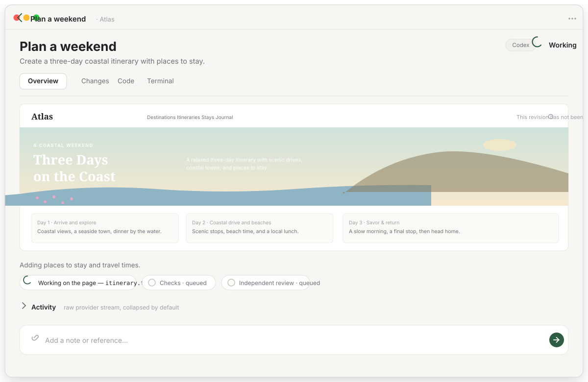
- 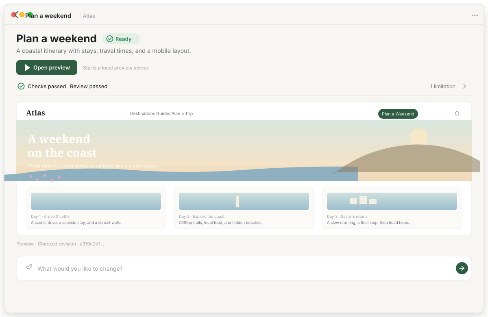

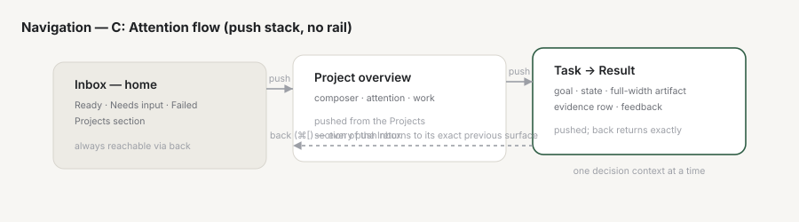

### Behavioral expression

- **Attention is the home.** The window opens on exactly the things that need the
  user: Ready results, questions, failures — grouped, cross-project, with a
  “Projects” section underneath for everything else. If nothing needs attention,
  the empty state says so plainly.
- **One decision context at a time.** Pushing a task hides everything else; there is
  no split attention, and back is always to the exact previous surface.
- **Result = full window.** The pushed result surface has the maximum possible width
  for the artifact and the clearest possible evidence row.

### Strengths

- The purest expression of “attention replaces supervision”: the home screen *is* the
  decision queue, with no dashboard decoration.
- Most compact-window friendly composition of the three; each surface degrades
  gracefully because each owns 100% of the width.
- System back/forward behavior is the most native navigation idiom on macOS;
  focus-restoration rules are the simplest to specify (each push restores to its own
  surface).

### Risks

- **Loses persistent place-sense.** With no rail, jumping from one project's task to
  another's means back → queue → forward — every cross-project move is three steps.
  For a *workspace* (the issue's word) where the user returns to the same few
  projects daily, the sidebar's stability is the point.
- **The project overview has no home.** In C the overview is a push behind the
  project row in the queue; the “start work here” surface becomes secondary to the
  queue, which inverts the issue's primary flow (project → task → result).
- **Parallel work is invisible.** Several working tasks in different projects cannot
  be seen together; the queue only shows tasks with attention. Monitoring N
  concurrent tasks (#1728) degrades to counting queue entries.
- **Queue noise risk.** If the queue includes anything beyond Ready / Needs decision /
  Failed / Stale, it becomes a dashboard again; keeping it strict limits what the home
  can show.

### Tradeoffs

C is the strongest argument for what the Inbox screen should *look like* — and A's
Inbox surface adopts it: the queue with grouped sections is A's Inbox, reached from
the sidebar in one click. C as the *whole window* trades workspace stability for
queue purity. See D1.

---

## Criteria scorecard

✓ strong · ◐ partial · ✗ weak. The scorecard is a summary, not the argument — the
screens above are the argument.

| Criterion | A | B | C |
|---|---|---|---|
| Expresses project/task/result in window structure | ✓ | ◐ | ◐ |
| Home matches “start work” (project → composer) | ✓ | ✗ | ◐ (queue first) |
| Truthful current state (no fabricated progress) | ✓ | ✓ (terminal truth) | ✓ |
| Result prominence / full width for artifact | ✓ | ◐ (sheet) | ✓ |
| Ready discoverability (push, not pull) | ✓ (Inbox + sidebar + header) | ✗ (badge pull) | ✓ (home) |
| Cross-project attention (Inbox) | ✓ (reuses 2.x Inbox) | ◐ (rail badge) | ✓ (home) |
| Parallel task visibility (#1728) | ✓ (sidebar + overview) | ◐ (rail) | ✗ |
| Power-user terminal continuity | ✓ (1 tab) | ✓ (home) | ◐ (1 tab) |
| Native navigation idiom | ✓ (document-style) | ◐ (overlay) | ✓ (stack/back) |
| Compact-window behavior | ◐ (needs collapse rules) | ◐ | ✓ |
| Consistency with archive visual language | ✓ | ✗ (dark home) | ✓ |
| New-surface build risk | highest | medium | high |
